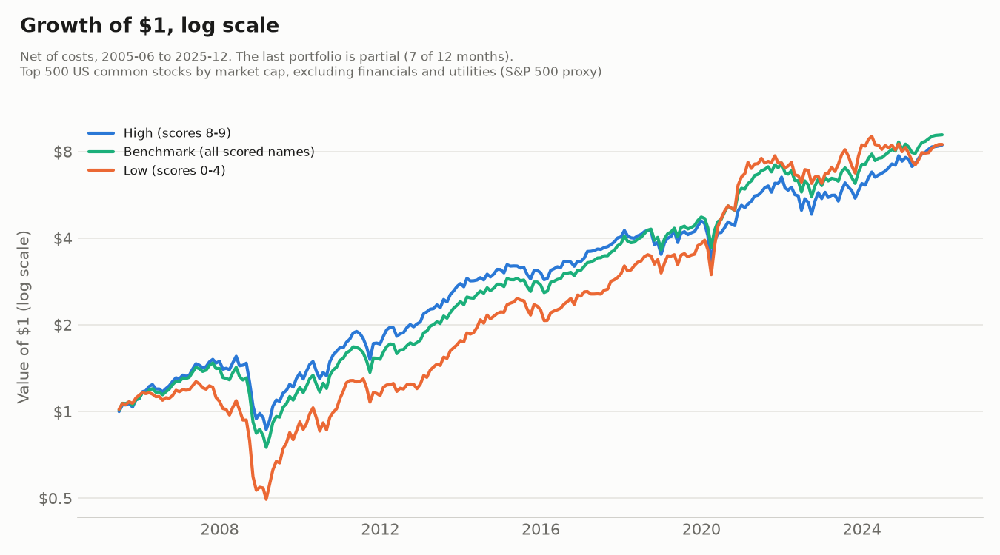
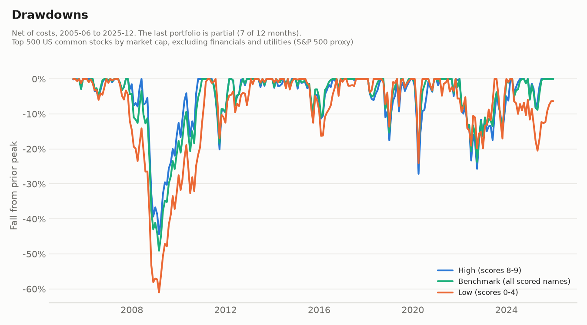
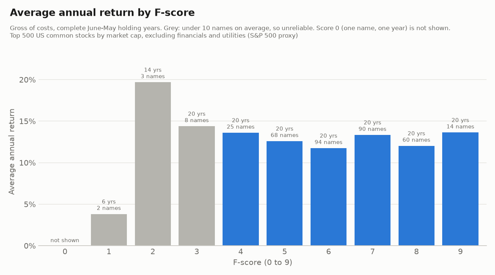

# Piotroski F-score test: write-up

**Universe:** Top 500 US common stocks by market cap, excluding financials and utilities (S&P 500 proxy)

**Test period:** June 2005 to December 2025. The test ends before 2026, and the last portfolio is partial (7 of its 12 months).

This repository holds the code, the write-up and summary tables only. Licensed WRDS data is not included, and neither are the detailed files derived from it. Files named in the text but not present here, such as logs and monthly or company-level tables, are produced when you run the scripts with your own WRDS access. A few company-level cells were removed from the published summaries, so a rerun will show more than this copy does.

## The answer

No. Buying the financially strongest companies in this universe, those with an F-score of 8 or 9, did not beat an equal-weighted portfolio of all the scored companies. High grew 10.91% a year after costs, against 11.35% for that benchmark, with similar risk, and it beat the benchmark in 10 of 20 complete years. After accounting for market, size, value, profitability, investment and momentum factors, High's alpha was -0.8% a year (t-stat -0.71), which is not distinguishable from zero. A small edge in either direction can't be ruled out: the 95% ranges are about -2.0% to +1.4% a year for excess return and -2.9% to +1.4% for alpha. High did better than the benchmark in the first decade and worse in the second, neither significantly on raw return (+1.02% a year, t 1.04; -1.53%, t -1.22), although the factor-adjusted gap in the second decade was -2.63% (t -2.30, about -2 after allowing for how often this test overstates; see Results). None of the 9 robustness variants produced a significant positive alpha over the full period. This tests large US companies, not the cheap, smaller companies Piotroski studied, so it does not test his original claim.

## Terms

- **F-score:** a 0-9 count of financial-health tests a company passes, from its latest annual report.
- **High, Middle, Low:** portfolios of scores 8-9, 5-7 and 0-4.
- **Benchmark:** every scored company in the universe, equally weighted, run the same way and charged the same costs.
- **Net / gross:** after / before trading costs.
- **CAGR:** the constant yearly growth rate that gives the same end value.
- **Volatility:** how much monthly returns swing, stated per year.
- **Sharpe ratio:** return above the risk-free rate per unit of volatility. Higher is better.
- **Max drawdown:** the largest peak-to-trough fall.
- **Turnover:** the share of a portfolio traded at a rebalance. Two-way counts buys and sells.
- **Excess return:** return above the benchmark, here the average monthly gap times 12.
- **Tracking error:** how much the return gap to the benchmark swings, stated per year.
- **Information ratio:** excess return divided by tracking error.
- **REIT:** real estate investment trust, a company that mainly owns property or property loans and passes most income to shareholders.
- **GICS:** the Global Industry Classification Standard, the sector system used here.
- **Rank correlation:** how closely two orderings agree, from -1 (opposite) to +1 (identical).
- **Factor:** a broad return pattern: market, size (SMB), value (HML), profitability (RMW), investment (CMA) and momentum (MOM).
- **Alpha:** return left after accounting for those factors, stated per year.
- **t-stat:** how many standard errors a number is from zero. Beyond 2 in either direction is treated as significant here.
- **Newey-West:** standard errors adjusted for returns that are correlated over time, here over 12 months.
- **Spread:** High minus Low. A diagnostic only, with no shorting costs.
- **Availability date:** the first date a number could be used: the 10-K filing date, or the fiscal year-end plus 120 days if there is none.
- **PERMCO / PERMNO / GVKEY:** the CRSP company ID, CRSP security ID and Compustat company ID.
- **Stub year:** a fiscal year with an unusual length, usually from changing the year-end.

## Method

All rules are in `config.py`, and the decisions are recorded in `CLAUDE.md`.

- **Universe:** on the last trading day of each May, 2005-2025, the top 500 US-incorporated common stocks on NYSE, Nasdaq or NYSE American by market cap, rebuilt from data on that date. Financials and utilities are removed after ranking.
- **Scores:** the nine Piotroski tests from Compustat annual data, for fiscal years 2004-2024. The rules are in `CLAUDE.md`. Three readings differ from Piotroski's paper as recalled by the audit, not checked against its text: net income rather than income before extraordinary items, a share rise of up to 2% still passes the no-issuance test, and a company with no long-term debt in both years passes the leverage test. In a later check, a sensitivity seen after results that changed no rule, removing the 2% tolerance gave a High alpha of -0.08% (t -0.08), a 5% tolerance -1.24% (t -1.30), and failing the no-debt case -1.09% (t -0.97). None is significant. In 2015-25, all three stay beyond |t| of 2 (-3.18%, t -3.40; -3.71%, t -4.55; -4.17%, t -4.23). The net income reading was not tested, because income before extraordinary items is not in the project's data. Each portfolio uses the latest score available by the formation date, no more than 18 calendar months past its fiscal year-end.
- **Portfolios:** equal weight at formation, held 12 months from June. Returns include delisting returns, and a delisted stock's value goes pro rata to the rest.
- **Costs:** 10 basis points (0.10%) on each dollar bought or sold at each rebalance. The first portfolio is charged as bought from cash. High's costs were about 0.16% a year.
- **Secondary benchmarks:** RSP and SPY fund returns.

## Results

All figures are net of costs. June 2005 to December 2025, 247 months.

| Portfolio | CAGR | Volatility | Sharpe | Max drawdown | Average two-way turnover |
|---|---|---|---|---|---|
| High (8-9) | 10.91% | 16.79% | 0.60 | -44.4% | 164% |
| Middle (5-7) | 11.26% | 15.85% | 0.65 | -49.8% | 81% |
| Low (0-4) | 10.93% | 19.85% | 0.54 | -61.0% | 176% |
| Benchmark | 11.35% | 16.17% | 0.65 | -49.1% | 34% |
| RSP | 9.85% | 17.00% | 0.54 | -55.6% | n/a |
| SPY | 10.88% | 14.90% | 0.66 | -50.8% | n/a |

| High against the Benchmark | Value |
|---|---|
| Excess return | -0.29% a year (t -0.34) |
| Tracking error | 3.69% |
| Information ratio | -0.08 |
| Complete years High won | 10 of 20 |
| 2025 partial (7 of 12 months) | High 11.20%, Benchmark 10.37% |

| Factor regression, net | Alpha a year | t-stat | Market | SMB | HML | RMW | CMA | MOM |
|---|---|---|---|---|---|---|---|---|
| High minus risk-free rate | -0.78% | -0.71 | 1.02 | 0.18 | -0.05 | 0.19 | 0.04 | 0.00 |
| Spread | -2.0% | -0.72 | -0.02 | -0.14 | 0.07 | 0.47 | 0.04 | 0.07 |

| Subperiod, net | High CAGR | Benchmark CAGR | High excess | High alpha (t) | Spread alpha (t) |
|---|---|---|---|---|---|
| June 2005 to May 2015 | 12.3% | 11.2% | +1.0% | +2.5% (1.76) | +2.1% (0.51) |
| June 2015 to December 2025 | 9.6% | 11.5% | -1.5% | -3.8% (-4.10) | -5.7% (-1.49) |

The 2015-25 figure needs its context:

> High's alpha for June 2015 to December 2025 was -3.8% a year, t -4.10 with the pre-set 12 lags (-2.47 without adjustment; -3.06 with 4 lags). In simulations, 12 lags on 127 months overstate significance somewhat, implying a t nearer -3.4 to -4.0. Randomly chosen portfolios from the same universe also averaged -1.3%, and 19% of them reached |t| of 2 or more. The alpha falls in the lowest 1.5% of random selections, but the lowest 11% if the random selections keep High's sector mix. The full-period alpha is -0.8%, t -0.71, and 2005-15 has the opposite sign.

Taken together, a t of about -2.5 to -3.6 is defensible, not -4.10 alone.

The gap between High and the Benchmark in 2015-25 was -1.53% a year on raw return (t -1.22) and -2.63% (t -2.30) after the factors. In simulations that t is about -2 (p 0.04 to 0.07), and the gap falls in the lowest 11% of random selections that keep High's sector mix.

**By individual score:** returns do not rise with the score. Scores 4-9 averaged 11.75% to 13.63% a year, gross, over complete years. The rank correlation of score with average return is -0.32 across all 10 scores, but scores 0-3 average under 10 names and score 0 is one name in one year. It is +0.14 across the 6 scores with enough names. Neither figure is a test of significance.

The year-by-year table is in `output/tables/year_by_year.csv`.

## Robustness

Each row changes one setting. The headline stays the headline whatever these show, and every variant run is reported. The variant definitions were set after headline returns existed; the timing of two later rules is under Robustness timing below. All are net of costs.

| Variant | High alpha | t-stat | High minus Benchmark | High Sharpe | Benchmark Sharpe | Benchmark CAGR |
|---|---|---|---|---|---|---|
| **Headline** | -0.78% | -0.71 | -0.29% | 0.60 | 0.65 | 11.35% |
| High cutoff 7+ | -0.22% | -0.30 | +0.09% | 0.65 | 0.65 | 11.35% |
| Version B: cheapest third | -1.11% | -0.59 | -0.00% | 0.50 | 0.55 | 10.35% |
| Cap-weighted | -0.78% | -0.54 | -0.99% | 0.63 | 0.78 | 12.64% |
| Sector-neutral | -0.48% | -0.55 | -0.18% | 0.61 | 0.65 | 11.35% |
| Fallback lag 90 days | -0.78% | -0.71 | -0.29% | 0.60 | 0.65 | 11.35% |
| Costs 25 bps | -1.02% | -0.94 | -0.48% | 0.59 | 0.64 | 11.28% |
| Eight-signal | -0.97% | -0.90 | -0.11% | 0.59 | 0.62 | 10.91% |
| Universe buffer | -0.72% | -0.64 | -0.33% | 0.61 | 0.65 | 11.40% |
| Profitability screen | -0.78% | -0.70 | -0.03% | 0.61 | 0.65 | 11.12% |

| Variant | High, median names (minimum) | Low, median names (minimum) | Benchmark, median names | Dates under 10 names |
|---|---|---|---|---|
| Headline | 73 (43) | 31 (20) | 365 | none |
| High cutoff 7+ | 170 (113) | 31 (20) | 365 | none |
| Version B | 23 (8) | 13 (4) | 122 | **High 1, Low 8** |
| Cap-weighted, sector-neutral, lag 90, costs 25 bps | 73 (43) | 31 (20) | 365 | none |
| Eight-signal | 73 (46) | 32 (20) | 395 | none |
| Universe buffer | 68 (42) | 32 (20) | 359 | none |
| Profitability screen | 70 (43) | 18 (8) | 316 | **Low 2** |

| Variant, High alpha (t) | June 2005 to May 2015 | June 2015 to December 2025 |
|---|---|---|
| Headline | +2.5% (1.76) | -3.8% (-4.10) |
| High cutoff 7+ | +1.7% (1.89) | -2.1% (-2.61) |
| Version B | +3.2% (1.37) | -5.5% (-2.91) |
| Cap-weighted | -0.1% (-0.07) | -1.7% (-0.87) |
| Sector-neutral | +1.7% (1.51) | -2.9% (-3.36) |
| Lag 90 days | +2.5% (1.76) | -3.8% (-4.10) |
| Costs 25 bps | +2.2% (1.57) | -4.1% (-4.45) |
| Eight-signal | +2.3% (1.68) | -4.0% (-4.33) |
| Universe buffer | +2.4% (1.56) | -3.6% (-3.41) |
| Profitability screen | +2.7% (1.94) | -4.0% (-4.17) |

**What this shows:**

- **Full period:** no variant has a significant High alpha, and all nine are slightly negative (t from -0.30 to -0.94). No variant's full-period spread alpha is significant either.
- **The time pattern is not independently confirmed.** High's alpha is lower in 2015-25 than 2005-15 in every variant, and it reaches |t| of 2 in 8 of 9. These are not separate tests: most variants hold nearly the same stocks (Lag 90 days is identical to the headline), and across all 10 series there are only about 4 to 5 effectively separate tests. The variant that differs most, cap-weighted, is not significant (t -0.87). The same lag caution applies, and the benchmark itself runs negative in that period.
- **Version B is the closest to Piotroski's sample,** because he studied cheap stocks. It is still large companies only. It holds the cheapest third by book-to-market, ranked among scored USD names on each date. Book equity is common equity plus deferred taxes (`ceq + txditc`, a null `txditc` counting as zero); non-positive book equity stays ranked and is never cheapest. High matched its own cheap-third benchmark on average return (-0.00% a year), though it compounded more slowly (9.96% vs 10.35%), with an alpha of -1.11% (t -0.59). Its Low bucket is thin (under 10 names on 8 of 21 dates), so its spread is noisy.
- **Version B bug fix, found after results:** the first run missed 7 rows that sit exactly on the two-thirds point (Coventry 2007, Bath & Body Works 2008, Constellation 2014, Target 2016, Cerner 2021, AMD 2023, TransUnion 2025), because of a floating-point rounding error, contrary to the approved rule. Correcting it to the approved rule lowered the result. High alpha went from -0.87% (t -0.46) to -1.11% (t -0.59); 2015-25 alpha from -5.10% (t -2.68) to -5.51% (t -2.91); and High minus Benchmark from +0.21% to -0.00% a year. Only two of the seven, Target and TransUnion, are High names, which shows how sensitive this thin variant is to one or two names. The headline does not use this column and did not move.
- **Cap-weighted:** High's gap to the benchmark widens to -0.99% a year, against a benchmark growing 12.64%. In that variant, the 2015-25 spread alpha reaches t -2.03, but that is one of 60 alpha tests in these tables, and chance could produce one such result among that many.
- **Lag 90 days is identical to the headline:** no list row changes. Only one fallback date crosses a May date (UiPath, fiscal year ending January 2021, May 2021 list), and it changes no score.
- **Eight-signal:** 641 list rows use 8 signals (31 High, 578 Middle, 32 Low), mostly real estate and financial-sector REITs (429 rows) and some industrial and consumer firms. The benchmark falls from 11.35% to 10.91% a year. Buckets: High 8, Low 0-3, Middle 4-7, out of 8.
- **Universe buffer:** names enter at rank 450 or better and stay until they pass rank 550, starting from the 2005 top 500. Lists hold 481-501 companies before exclusions, and 318-377 are scored.
- **Profitability screen:** it requires positive trailing-four-quarter and latest-quarter net income, across every bucket and the benchmark. It overlaps with F_ROA, and it removes far more of Low than of High. Of 7,571 rows, 6,582 pass, 973 fail on earnings and 16 are unconfirmed (14 null earnings, 2 non-consecutive quarters), which count as failing. High loses 74 of 1,553 rows and Low loses 350 of 728. Quarterly availability uses the 10-Q or 10-K filing date with the same 120-day fallback, not the earnings announcement date; 26 list rows have a fallback date on their newest quarter. Quarterly net income comes from current Compustat, so it has the same restatement limit as the annual data.
- **Null returns held flat:** two cases have no return without being exits, and each is treated as flat in its variant only. General Growth Properties, May 2009 (eight-signal), and Comverse Technology, February to May 2007 (buffer, on the 2006 list, sold at its last value at the 2007 rebalance). Comverse is one name out of 221 in Middle and 331 in the Benchmark that year; holding it flat instead of treating it as an exit lowers full-period growth by 0.16 basis points a year for Middle and 0.11 for the Benchmark, and High and Low are unaffected. Any other null in a held position stops the run, and none occurred.

Full results: `output/tables/robustness_comparison.csv`, `output/tables/robustness_subperiods.csv`, `output/robustness/`.

## Limitations and disclosures

**The universe is a proxy.**

- It is not the official S&P 500, because S&P membership history was not available. The 2025 list holds 418 of the 500 current S&P members, an overlap of 83.6%. That membership is as of October 2026, not May 2025. Of the 82 missing, 47 rank below 500, 29 are incorporated outside the US (such as Linde, Accenture and Medtronic), 5 have no valid link, and 1 is Cboe, whose listing is excluded by rule.
- Partnerships coded as units, such as Enterprise Products, are excluded.
- The check on 375-425 names per date was set after the counts were known, before any returns, and is a sanity check only. Actual range: 378-417.
- 500th-company market cap: the 2021 move of +63.6% is flagged and looks market-wide. The May date shows no 2020 dip (+0.8%), though the same cutoff fell in March 2020.

**Who is in and out.**

- Equity REITs stay in on all dates, including while GICS classed them in Financials. Mortgage REITs (lenders) are excluded on all dates, by dated GICS sub-industry plus one named exception, iStar 2005, which carries a generic code. That exception is a judgment call. 19 company-dates are affected.
- Visa, Mastercard and PayPal leave the universe when GICS moved them to Financials in March 2023.
- CBRE, which is not a REIT, is excluded through 2016 and included from 2017 after the Real Estate sector change.
- If the held share class has no valid link, the GVKEY comes from the same PERMCO when it has exactly one, and returns still come from the held class. This was used 34 times across 8 companies, including Alphabet 2014-2022.
- Eaton 2005-2012 and Ceridian 2020 drop out under the link filter. Dell 2017-18 and Liberty Media LSXMK 2016-17 have no GVKEY and are excluded.
- Yahoo 2005-2017 has no sector on the date and is excluded.
- Securities that stopped trading before the formation date are removed before ranking.

**The test effectively excludes some companies.** A company-year with any uncomputable signal is dropped. That effectively excludes traditional REITs, most homebuilders and finance-arm firms, which have no current assets or liabilities in Compustat. Only 26 of 247 kept REIT rows in Financials and 64 of 274 Real Estate rows have a score, against 91%-97% in other sectors. The eight-signal variant shows the effect of including them.

**The benchmark choice matters to the sign of the raw gap.** The Benchmark holds scored names only, which compares like with like. In a later check, a sensitivity seen after results that changed no rule, the 843 unscored rows earned 6.24% a year gross (alpha -4.18%, t -2.01). Against all included names (10.79% net), High's raw gap is +0.19% a year (t 0.22), with alpha -0.44% (t -0.45), and is still not significant.

**Low is broader than Piotroski's weak group.** `LOW_SCORES` was changed from 0-2 to 0-4 on name counts only, before any returns: scores 0-2 had a median of 2 names a date and were empty in 2006, 2007 and 2011. Middle is therefore 5-7.

**Data limits.**

- Restatements: Fundamentals come from the current Compustat database, not a record of what was reported at the time, while availability dates use original 10-K filing dates. In a test on a sample of 1,480 companies for 2005-2015, 98.5% of F-scores matched those computable at the time and 0.2% changed bucket. Any remaining look-ahead from restated figures could not be measured for the whole sample or for later years. Only 55 of those companies are in this project; for them, 97.3% matched and 0.45% changed bucket. The test ends with fiscal 2014 and uses today's share adjustment.
- Returns end in December 2025, so the 2025 portfolio is partial, and the last subperiod ends then.
- The thin May 2005 list: 25 companies with January-May year-ends have no score that year, because the data pull is not extended. 318 of 384 included names are scored on that date.
- Two companies report in Canadian dollars (11 rows). They are not converted. Ratios are unaffected, and their 3 list rows (Tim Hortons) are excluded from version B only.

**Timing and accounting choices.**

- Fallback lag: 2.91% of fiscal 2004-2024 company-years with assets use year-end + 120 days, but only 6 of 7,571 chosen list rows do.
- 10-K filings over 120 days late: 108. Over a year late: 13, such as Maxim FY2006 and Fannie Mae FY2004. They are real dates and are used.
- 13 list rows use an older fiscal year because the newest available year has no score (such as Best Buy, Mastercard and Salesforce). 15 list rows were filed on the formation date itself and may not have been known at that day's close.
- Same-day filings are resolved to the later fiscal year (Maxim, United Rentals). Availability order inverts for H&R Block FY2021 and Super Micro FY2017, and no list row is affected.
- Fiscal-year changes: 49 stub years are flagged, and no year-over-year comparison runs into or out of them. Share counts under 1 million are treated as placeholders, so the share test is not computed. Margin is not computed when sales are zero or negative.
- Year-over-year moves above 10x are flagged, never dropped: assets 15, sales 42, adjusted shares 64.

**Merger and separation years are kept.** 270 list rows have 2x-10x moves in assets or sales, including real company split-ups, and these distort year-over-year tests. 20 GVKEYs span two PERMCOs over time. Comparisons that look invalid and reach a list: DuPont FY2017-18, Match FY2020-21, Starz FY2011, Dell FY2018 and Kraft Heinz FY2016. Splits that keep the same PERMCO, such as DuPont FY2019, are not caught by this test. See `output/tables/permco_joins_review.csv`.

**Portfolio mechanics.**

- 4 included names delist on the formation date (CNX Gas 2010, Pride 2011, Waste Connections 2016, Valspar 2017) and have no later returns. Their weight is spread pro rata in the first holding month, and they are charged as buys. Waste Connections continued under PERMNO 92949; in a later check, following it moves the Spread alpha from -2.04% to -2.06%, with High unchanged.
- 179 mid-period exits (High 32, Middle 125, Low 22). Reinvesting their proceeds is not charged.
- RSP has two rows for April 2018 and they are chained into one return.
- The spread carries no shorting costs, and its -65.9% drawdown compounds a long-short series with no financing, so it is a rough diagnostic only.
- The published net Spread column subtracts Low's net return from High's, which credits Low's trading costs to the spread by about 0.35 points a year. It stays as published, at -0.57% a year (alpha -2.04%, t -0.72). With both legs charged, the Spread is -0.92% a year (alpha -2.39%, t -0.85).
- t-stats use no small-sample correction, and significance is a fixed |t| of 2.

**Robustness timing.** The robustness definitions and null-return rules were set after the headline existed. The independent builder's first variant run and the main build's crashed run existed before two later rules were settled: the Comverse hold-flat rule and the instruction to use the quantile boundary for version B. By the coordinator's record, those results were not reported to the coordinator or the other builder, but each author had access to its own, so these rules were not set blind. Also by the coordinator's record, the Comverse rule was recommended by the independent builder, whose first run already held Comverse flat, before the two builds' results were compared. No file can show the order of these events: the repository's history begins after these events, and file dates show only the last save. The rule's effect is -0.16 basis points a year on Middle and -0.11 on the Benchmark, with High and Low unaffected. Bucket placement for the eight-signal version could not be set before any returns existed, as first planned.

## Drop counts

| Stage | Count | Detail |
|---|---|---|
| Securities removed before ranking, security-dates | 72,677 | Stopped trading 727; not US-incorporated 20,572; funds, ETFs and closed-end funds 47,816; other exchange 1,494; share type 2,060; missing price 8 |
| Companies on the 21 lists | 10,500 | Exactly 500 a date |
| No GVKEY | 13 | Eaton 8, Dell 2, Liberty 2, Ceridian 1 |
| No sector | 13 | Yahoo |
| Sector exclusions | 2,060 | Financials and utilities, of which 19 are mortgage REITs; 247 equity REITs kept |
| **Included company-dates** | **8,414** | |
| No score known by the date | 794 | |
| Score too old | 49 | |
| **Held company-dates** | **7,571** | |

| Score stage | Count |
|---|---|
| Company-years, FY2004-2024 | 18,265 |
| Scored | 13,993 |
| **Dropped** | **4,272** |

| Signal | Uncomputable | Flagged year | No prior year | No comparison two years back | Null input | Sale or share minimum |
|---|---|---|---|---|---|---|
| F_ROA | 438 | 89 | 226 | 0 | 123 | 0 |
| F_CFO | 441 | 89 | 226 | 0 | 126 | 0 |
| F_DROA | 742 | 89 | 226 | 289 | 138 | 0 |
| F_ACCRUAL | 441 | 89 | 226 | 0 | 126 | 0 |
| F_DLEVER | 751 | 89 | 226 | 240 | 196 | 0 |
| F_DLIQUID | 3,662 | 89 | 226 | 0 | 3,347 | 0 |
| F_EQ_OFFER | 815 | 89 | 226 | 0 | 399 | 101 |
| F_DMARGIN | 510 | 89 | 226 | 0 | 131 | 64 |
| F_DTURN | 742 | 89 | 226 | 289 | 138 | 0 |

A company-year can miss several signals, so these overlap. 3,124 company-years are dropped for F_DLIQUID alone.

## Verification

The user's hand-check of four companies against their 10-Ks matched. Independent rebuilds of the universe, scores and headline returns, and audits of each phase, are in `verification/`. They found no look-ahead, survivorship or return bug, and placebo tests (the same run with shuffled scores) behaved as expected. Those checks describe this sample and these methods. They do not show that the 2015-25 shortfall would continue. The robustness runs were independently rebuilt and audited: all 10 series match. A rebuild does not test the rules and data the builds share, so it shows the rules were implemented consistently, not that they are the right rules or that the data is true. The version B rounding error is an example: both builds first matched exactly while sharing it, and a separate audit found it.

A final re-audit tested the finished project at one commit. From a clean copy with no data folder, the scripts ran through once a helper outside the numbered order was added, and every data file, result table and chart matched. A line-by-line read of the scoring code and cross-checks from other angles found no wrong number. The sensitivities in this write-up to the share tolerance, the zero-debt rule and the benchmark came from that re-audit (`verification/reaudit_agent3.md`). It led to label, log and wording fixes, a clearer run order and one count correction, and no rule, score or return changed. The count correction applied a date tie-break in `04_scores.py`: score 8 went from 1,255 to 1,256 list rows and 2009 sector 45 from 65 to 66, both now agreeing with the formation file, with no change to any portfolio. It did not establish that the rules are the right ones, that later WRDS pulls would match, or who saw which result when, and the clean-copy runs used the same machine, saved login and same-day data. After the fixes, a second clean copy ran all scripts in the numbered order from no data folder, and every data file, result table and chart matched.

## Runs after this write-up

The user asked for three further runs after this write-up was finished. **None of them is the headline, and none changes a figure or the answer above.** Each has its own folder, and new data went into new files. All are for the same universe, the Top 500 US common stocks by market cap, excluding financials and utilities (S&P 500 proxy), and all figures are net of costs.

Each run's monthly returns were independently rebuilt or audited (`verification/data_audit_post_writeup.md`, `verification/data_audit_long_short.md`). A rebuild shows the arithmetic is right, not that a rule is the right one.

### 2026 extension: not the headline

This holds the 2025 portfolio through May 2026, so that 2025-26 becomes a complete year, with no new rebalance or cost.

The January-May 2026 extension uses Compustat monthly returns because CRSP data on this account ends in December 2025. It is reported separately and does not change any headline figure. On 15,752 earlier held months, Compustat agrees with CRSP within 1% on 99.96%, but it differs at spin-offs (up to 8.4 points on a single stock) and at delistings. Two spin-offs (Becton Dickinson, Comcast) and two acquisitions (Hologic, Coterra) fall in the window. No bankruptcies do.

| | Headline, to December 2025 | Extended, to May 2026 |
|---|---|---|
| High CAGR | 10.91% | 11.44% |
| Benchmark CAGR | 11.35% | 11.86% |
| High minus Benchmark, a year | -0.29% | -0.26% |
| High alpha (t) | -0.78% (-0.71) | -0.47% (-0.42) |
| High minus Benchmark alpha (t) | -0.95% (-1.02) | -0.85% (-0.91) |
| Spread alpha (t) | -2.04% (-0.72) | -2.83% (-1.01) |
| Average Spread a year | -0.57% | -1.71% |
| High alpha from June 2015 (t) | -3.83% (-4.10) | -3.25% (-3.16) |
| Complete years High won | 10 of 20 | 11 of 21 |

January-May 2026 alone: High +15.36%, Middle +11.12%, Low +45.07%, Benchmark +15.16%, RSP +9.48%, SPY +11.24%.

- **Few names carry it.** Western Digital and Intel supply 29.4 of Low's 45.07 points, and Micron 9.06 of High's 15.36. Those positions were large because the fixed 12-month hold let them drift there. The rest is breadth: 84.8% of Low rose against 51.4% of High, with a median stock of +16.7% against +0.3%.
- **Five months say little.** The window adds no real evidence on whether the F-score works. It is one narrow episode, part of one holding year, about one sector-driven market move, and it should not strengthen or weaken the headline in either direction. Average Spread three times larger after 5 of 252 months should not be read as a stronger trend.
- **The t of -3.16 needs the same lag caution.** It is about -2.7 to -3.2, and about -2 with no lag allowance. The alpha falls in the lowest 1.7% of random selections, but the lowest 12.5% if they keep High's sector mix.
- **Data.** The prices were confirmed against a separate vendor, but month-end prices and spin-off treatment have only S&P sources. CRSP cannot check these months yet, and they should be compared with it when it can.

Source files: `output/extension_2026/results.md`, `validation.md`, `returns.csv`, `contributors_jan_may_2026.csv`; `09a_extension_pull.py`, `10_extension_2026.py`, `10a_extension_contributors.py`; `data/raw/comp_secm_extension.parquet`.

### REIT liquidity substitute: not the headline, not a blind test

The headline effectively excludes traditional REITs, because they have no current ratio. Here a row-level REIT with no liquidity signal uses a rise in cash to total liabilities (`che / lt`) instead, on the same 0-9 scale and buckets. The rule was set after similar variants had been seen. It covers June 2005 to December 2025 on CRSP.

| | Headline | REIT substitute |
|---|---|---|
| Scored REIT rows | 80 of 512 (15.6%) | 510 of 512 (99.6%) |
| High CAGR | 10.91% | 10.63% |
| Benchmark CAGR | 11.35% | 11.06% |
| High minus Benchmark, a year | -0.29% | -0.30% |
| High alpha (t) | -0.78% (-0.71) | -1.01% (-0.91) |
| High minus Benchmark alpha (t) | -0.95% (-1.02) | -0.96% (-1.00) |
| 2015-25 High alpha (t) | -3.83% (-4.10) | -4.24% (-4.40) |

It adds 430 list rows (High 61, Middle 302, Low 67) across 44 companies. The signal passes 48.1% of the time.

- **This is the same result, not new evidence.** Its monthly returns correlate 0.9989 with the headline's. Most of the fall in alpha comes from adding REITs of any kind, in both High and the Benchmark, so the score is not choosing worse REITs. The variant shows that the headline result holds when most missing REITs are added, and that REITs were weak in that decade. The rise in t from -4.10 to -4.40 should not be quoted as stronger evidence, and the same lag caution applies.
- **The signal is noisy.** The median REIT holds cash of 2.75% of liabilities, so it mostly reflects year-end cash timing.
- **Still dropped.** 211 included rows still miss only the liquidity signal, all non-REITs. 2 REIT rows miss another signal.

Source files: `output/reit_liquidity_substitute/results.md`, `rows_added.csv`, `portfolio_returns.csv`; `09_reit_liquidity.py`; `data/raw/comp_funda_reit_fields.parquet`.

### 100/100 long/short: not the headline, not a blind test

This holds 100% long High and 100% short Low against NAV (net asset value, the capital in the strategy), with cash earning the risk-free rate. The Spread had already been seen, so it is not a blind test. **The borrow fee is an assumption, not data.** Gross exposure is (long + short) / NAV and net exposure is (long - short) / NAV.

It is shown both ways, and the two should be read together. The annual reset is the locked rule: a position opened 100/100 and left alone for 12 months. The monthly reset is a second view of a book held near 100/100, charged 10 basis points on each resize. The charged version was added after the locked result had been seen.

| June 2005 to December 2025, CRSP | CAGR | Volatility | Sharpe | Max drawdown | Alpha (t) |
|---|---|---|---|---|---|
| **Annual reset (locked), 0.50% borrow** | -1.80% | 12.27% | -0.22 | -75.8% | -4.53% (-1.48) |
| Annual reset, 2.00% borrow | -3.43% | 12.42% | -0.35 | -80.7% | -6.18% (-1.98) |
| **Monthly reset, charged, 0.50% borrow** | -0.42% | 10.41% | -0.15 | -67.5% | -3.00% (-1.06) |
| Monthly reset, charged, 2.00% borrow | -1.90% | 10.41% | -0.29 | -73.5% | -4.50% (-1.60) |
| Long-only High | 10.91% | 16.79% | 0.60 | -44.4% | -0.78% (-0.71) |
| Benchmark | 11.35% | 16.17% | 0.65 | -49.1% | +0.18% (0.25) |

| To May 2026, Compustat from January 2026 | CAGR | Alpha (t) |
|---|---|---|
| Annual reset, 0.50% borrow | -3.59% | -5.80% (-1.86) |
| Annual reset, 2.00% borrow | -5.23% | -7.49% (-2.35) |
| Monthly reset, charged, 0.50% borrow | -1.55% | -3.78% (-1.35) |
| Monthly reset, charged, 2.00% borrow | -3.02% | -5.28% (-1.89) |

- **"100/100" describes June only under the annual reset.** Gross exposure peaked at 5.0x, with net -0.70, at the end of February 2021. At the end of May 2026 the short is 243% of NAV, and Western Digital alone 46%. Few managers or brokers would let a book run to that size, and no margin limit is modelled.
- **The reset choice is much of the loss, but it does not create the negative result.** The annual reset accounts for 1.38 of the 1.80 points, measured against the charged monthly reset. CAGR stays below zero and alpha negative at every reset frequency tested.
- **Against the Spread.** The Spread with both legs charged is -0.92% a year. Return above cash falls further, to -2.71%, because of the 0.53-point borrow fee and 1.25 points from the annual reset: a size effect of -0.60 (legs larger than NAV) and a net-exposure effect of -0.65 (the book largest and most net short when Low runs ahead).
- **Significance.** No alpha over the main period reaches |t| of 2, and neither t of -2.35 is evidence about the F-score. Those are the 0.50% annual reset for June 2015 to May 2026 and the 2.00% annual reset for June 2005 to May 2026, both including Compustat months. Shuffled scores within sectors average t -2.11 for the first window, and 56.5% of them pass |t| of 2.
- **2025-26's -32.65% is mostly two Compustat-era names.** Without Western Digital and Intel it is +9.0%. Without those two and Micron it is -3.6%. This one year moves CAGR from -1.80% to -3.59%, which is too much weight on one year and one data source.
- **Real terms would differ.** Cash earning less than the risk-free rate would lower the result by about 1 point of CAGR for each point of haircut. A retail account with no interest on short proceeds would see about -3.43%. The audit's other tests on fees and on delisted shorts are in its report; recalls and borrow-fee spikes are not captured.

Source files: `output/long_short_100_100/results.md`, `performance.csv`, `exposure.csv`, `sensitivity_monthly_reset.csv`, `spread_both_legs_charged.csv`, `nav_main.csv`, `nav_extension.csv`; `11_long_short.py`.
